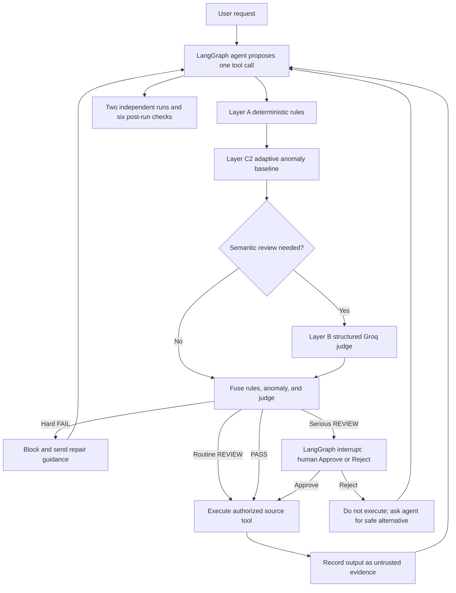

# Gmail + YouTube Research Agent

A local multi-source assistant using LangChain, LangGraph, Groq, Gmail OAuth,
and the YouTube Data API. A single Groq model routes requests to Gmail and
public YouTube tools. Gmail uses OAuth; public YouTube search/details use an
API key.

Gmail can search/read messages, create drafts, and send a single-recipient
email after explicit UI approval of the exact recipient, subject, and body.
These Gmail operations require the `gmail.readonly` and `gmail.compose` OAuth
scopes. YouTube access is limited to public video search and public
video/channel details. The YouTube Data API key does not provide transcripts
or private account access. Email text, proposed email content, and YouTube
metadata sent to the agent are forwarded to Groq for processing.

## Requirements

- Python 3.10 or newer
- A Google Cloud project with the Gmail API enabled
- A Google OAuth **Desktop app** client JSON file
- A Groq API key
- A YouTube Data API key with the YouTube Data API v3 enabled

## Configure credentials

Add the credentials to your local `.env` file in the project directory. Keep
them private; `.env`, the default OAuth token, and downloaded client JSON files
are ignored by Git.

```dotenv
GOOGLE_OAUTH_CLIENT_FILE=C:\private\client_secret.json
GROQ_API_KEY=your-groq-api-key
YOUTUBE_API_KEY=your-youtube-data-api-key
# Optional:
# GROQ_MODEL=openai/gpt-oss-120b
```

Enable **YouTube Data API v3** in the Google Cloud project that issued the
YouTube API key. Restrict the key to that API and, where practical, to this
application. The key is used only for public video search and public
video/channel details.

The app defaults to `openai/gpt-oss-120b`. If Groq reports that the model is
unavailable for your API key, choose an active model enabled for your account
in the Groq Console and set its exact model ID as `GROQ_MODEL` in `.env`.
To reduce Groq's tokens-per-minute usage, each search is limited to five
messages, snippets and message bodies are truncated, and at most 5,000
characters of message text are sent per question. If a 413 quota error occurs,
narrow the Gmail search/question or wait briefly before retrying.

In Google Cloud:

1. Enable the **Gmail API** in the project used by the OAuth client.
2. Configure the OAuth consent screen. If its audience is in testing mode,
   add the Gmail account you will connect as a test user.
3. In the consent screen's **Data Access** settings, add
   `https://www.googleapis.com/auth/gmail.readonly` and
   `https://www.googleapis.com/auth/gmail.compose`.
4. Keep using the OAuth **Desktop app** client JSON already configured in
   `.env`. Its localhost redirect is selected dynamically by the local app;
   no fixed redirect URL needs to be pasted into Google Cloud.

Both Gmail scopes are restricted scopes under Google's OAuth scope policy.
Local testing may display an unverified-app warning; external production use
may require Google's OAuth verification and additional security review. See
the [Gmail API OAuth scopes](https://developers.google.com/workspace/gmail/api/auth/scopes)
and [OAuth app verification](https://support.google.com/cloud/answer/13463073)
guidance.

## Install and run

From the project directory, run:

```powershell
python -m pip install -r requirements.txt
python -m streamlit run dashboard/app.py
```

Choose **Connect Gmail** and accept the requested read and compose permissions.
The authorized token is saved locally as `.gmail-token.json`. An existing
read-only token cannot grant compose permission: the app detects this and
starts consent again. If it does not, stop the app and delete only the local
token file (or the file named by `GMAIL_TOKEN_FILE`), then reconnect. Do not
delete the OAuth client JSON. Ask a question after Gmail is connected.

Draft and send tool calls pause for a UI decision. For a draft, approve the
displayed exact recipient, subject, and body to create it in Gmail Drafts. For
a send, use **Approve sending this exact email** only after reviewing those
same fields. Rejecting does not call Gmail. The second consistency pass cannot
create drafts or send messages. This implementation supports one recipient and
does not support CC, BCC, or attachments. A successful Gmail API response is
not independent proof of final delivery or persistent draft state.

The Source Desk dashboard provides a source selector, starter questions, and
recent searches. Selecting Gmail or YouTube binds only that source's tools to
the agent for the run; **Both sources** leaves both available. Results include
the trust report, run metrics, and expandable trace details.

The token and OAuth client file are credentials: do not share or commit them.
If access needs to be revoked, remove the app from your Google Account's
third-party connections and delete the local token file.

## Agent execution flow and hybrid trust supervisor

The single LangChain/Groq model is bound to Gmail and YouTube tools in a
LangGraph state graph. Every proposed tool action is checked before its
connector is called:



`agent/gmail_agent.py` names the graph nodes `agent`, `tools`, and
`limit_reached`. It processes one proposed tool call at a time so a review
interrupt cannot accidentally repeat an earlier connector call. Gmail reads
are checked by deterministic and semantic layers, but routine low-confidence
review signals are recorded for the final report without interrupting the
user. High-confidence warnings, critical anomalies, or reduced-assurance
decisions can pause for review. Draft creation and sending always require
approval of the exact recipient and message. Gmail tools are HIGH risk;
YouTube public search and details are LOW risk by default.

The layers are:

| Layer | Behavior |
|---|---|
| A — deterministic | Enforces registered tools, source scope, valid search arguments, YouTube query length, and Gmail read-after-search IDs. A hard failure cannot be overridden by the judge or a baseline. |
| B — semantic | Uses a low-temperature structured Pydantic judgment for user-intent alignment, causal source, claim support, paraphrased untrusted instructions, unexpected effects, verdict, confidence, and cited step numbers. Tool/email/YouTube text is labeled UNTRUSTED DATA in the judge prompt. Invalid structured output is retried once, then becomes UNKNOWN. |
| C2 — adaptive baseline | Learns tool order/set, run length, and query-length ranges only from runs explicitly confirmed as good. Deviations can trigger semantic review or REVIEW, never BLOCK by themselves. Stored baseline data contains tool names and numeric lengths, not email/query text. |
| Fusion | Combines hard rules, semantic verdict, anomaly score, configured thresholds, and risk. It records confidence, layers, latency, token usage, cited evidence, root-cause fields, and recommended action per proposed step. |

The six post-run checks remain available:

| Check | What this implementation measures | How to interpret it |
|---|---|---|
| Grounding | Whether answer sentences cite valid `[E#]` IDs from successful tool results. | Citation coverage, not proof that the cited text semantically entails a claim. |
| Contradiction | Explicit configured opposite-status terms between answer sentences and source evidence. | A possible conflict is a warning; subtle semantic conflicts can be missed. |
| Precondition / Postcondition | Whether a source call failed; successful Gmail compose calls are identified. | The API response is recorded, but draft persistence and final message delivery are not independently verified. |
| Scope creep | Whether a call used a connected Gmail or YouTube source implied by the question. | Source intent is inferred from words in the question; semantic action alignment is assessed by the judge. |
| Trajectory anomaly | Repeated identical tool names and arguments within one run. | A repeated call is flagged for review; a repeat is not by itself proof of a harmful loop. |
| Self-consistency | Normalized text similarity between two fresh runs of the same question. | Always runs a second Groq/Graph pass, so expect roughly twice the model usage and repeated source queries. Write tools are disabled in this pass. Similarity is lexical; paraphrases may score lower. |

Statuses are **PASS**, **REVIEW**, **NOT APPLICABLE**, **NOT ASSESSABLE**, or
**UNAVAILABLE**. These are bounded checks, not a guarantee of correctness or
safety. They complement the pre-tool hybrid gate; answer citation coverage and
lexical contradiction checks are not a substitute for semantic entailment.
YouTube search is limited to five results;
channel details are available only for channels returned by the current
search. This is one multi-source model, not separate specialist LLMs.

## Feedback and evaluation

UI verdict feedback is saved in `.agent-trust.sqlite`. It stores check labels,
run/task identifiers, and threshold history—not source text. Feedback can tune
the configured `T_anom` and `T_high` thresholds; the UI has an undo action for
the most recent change. Categorical feedback may be supplied as judge examples.
The same store holds aggregate behavior baselines after the user explicitly
confirms a run as good. `.agent-trust.sqlite` is local state and is ignored by
Git.

`tracer/evaluation.py` exposes `LabeledEvaluationCase`,
`VariantOutcome`, and `ablation_report()` for the variants `rules_only`,
`rules_plus_judge`, `rules_judge_adaptive`, `final_answer_judge`, and
`whole_trace_judge`. It reports detection, origin/manifestation accuracy,
false positives (including safe-but-suspicious traces), block/utility rates,
latency, and token counts. There is no labeled benchmark dataset in this
repository, so no measured ablation result is claimed until labeled cases are
provided.

The dashboard does not show a policy discovery/proposal workflow. Tool
availability is constrained by the tracer's built-in known-tool allowlist and
deterministic checks. Feedback and adaptive metrics are shown with the final
run report.

The LangGraph gate pauses in-memory using a checkpointer and resumes only when
the Approve or Reject UI control is selected. Trace arguments redact outgoing
message bodies; pending approval data necessarily holds the exact body in the
current Streamlit session/checkpointer memory so it can be reviewed and
executed. Adaptive persistence excludes raw message content.

The adaptive baseline does not learn recipient domains. Pre/postcondition
checks do not independently verify Gmail's resulting draft or delivery state.

## Tests

```powershell
python -m pytest tests -q
```

This app is currently for local desktop OAuth. Hosting it requires a Web
application OAuth client, a deployed callback URL, and secure server-side
credential storage.
